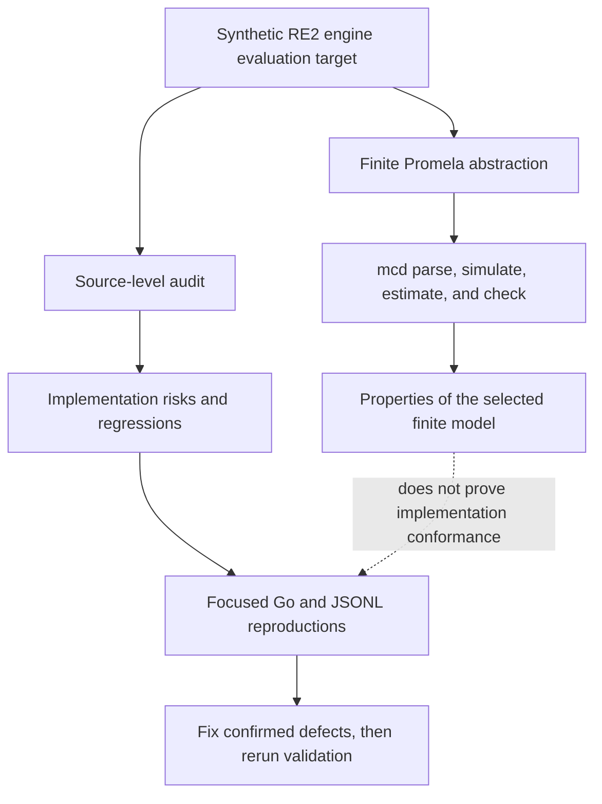
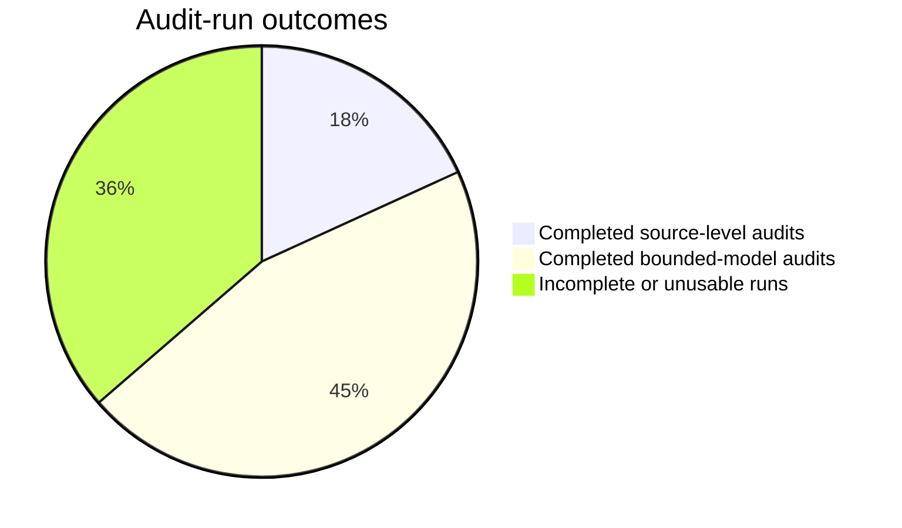
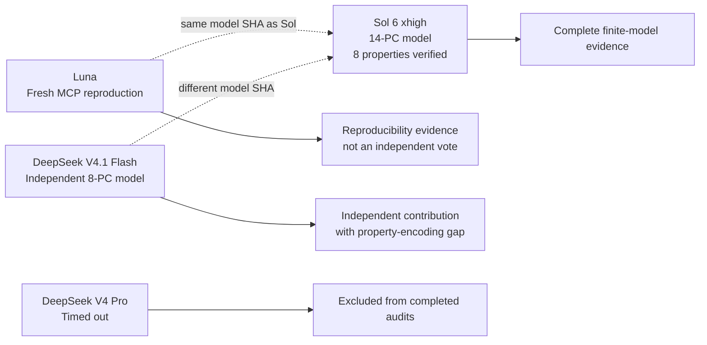

# Cross-model test comparison

This report compares the independent review and finite-model-checking runs performed
against the synthetic RE2 engine evaluation target. It records their completion,
evidence class, independence, and known limits. It is a status snapshot from
2026-10-14, not a claim that any finite model is conformant with an implementation.

The plugin's built-in `mcd` engine was used for the bounded-model runs. The source
under review was kept unchanged; review copies were isolated from the source tree.
Raw local audit bundles are not part of this public plugin artifact. This document
therefore reports only the retained outcomes, model identities, and interpretation
boundaries.

The audited source fixture is included at
[`../test-projects/synthetic-re2-engine/`](../test-projects/synthetic-re2-engine/).
It makes the target implementation, frozen JSONL cases, and local validation
instructions available without publishing private audit workspaces.

## Evidence boundary

Two evidence classes answer different questions:

1. **Source-level audits** inspect the Go implementation and its observable protocol.
   Their findings can motivate implementation tests and fixes, but historical source
   audit bundles must be reproduced before a release decision.
2. **Bounded-model audits** check hand-authored finite Promela abstractions. A
   `verified` result with exhaustive evidence establishes the selected property for
   that finite model and its stated assumptions only. It does not establish a
   refinement relation to the implementation.

The following diagram shows why these classes cannot substitute for one another.

## Run outcome snapshot

This chart counts runs by evidence class and completion state. It is an activity
summary, not an evidence-weight score: a completed finite-model run and a completed
source audit answer different questions.

## Comparison matrix

| Model or run | Evidence class | Completion | Reported result | Interpretation boundary |
|---|---|---|---|---|
| Claude Opus | Source-level audit | Completed | Reported likely risks in runtime boundedness, ordered match acceptance, JSONL protocol conformance, and resource limits | Historical result; directly relevant to the implementation, but its raw bundle is not retained in this plugin release. |
| Codex Terra | Source-level audit | Completed | Independently reported the same classes of implementation risks | Historical result; directly relevant to the implementation, but its raw bundle is not retained in this plugin release. |
| Coddy Qwen repeat | Bounded-model audit | Completed | Selected properties verified in a 33-state model | The abstraction was too small to rule out the reported implementation risks. |
| Coddy Gemma | Review/model audit | Timed out | No usable final verdict | No conclusion. |
| Coddy Kimi K2.6 | Review/model audit | Timed out | No report or formal artifacts | No conclusion. |
| Claude Sonnet 5.5 repeat | Bounded-model audit | Completed | Parsed model, baseline checks, and mutant counterexamples produced | Demonstrates the workflow and the selected model checks, not source correspondence. |
| Coddy Sol 6 high repeat | Bounded-model audit | Incomplete | Machine-readable MCP artifacts produced before the prose report timed out | No retained final report; not counted as a complete audit. |
| Coddy Sol 6 xhigh | Bounded-model audit | Completed | Eight requested properties `verified` with exhaustive evidence for a finite 14-PC Promela model | Strongest retained finite-model evidence. It remains evidence about the model, not the Go implementation. |
| Coddy Luna | Bounded-model audit | Completed | Eight requested properties `verified` in a fresh MCP session | Workflow reproduction only: it reused the Sol 6 xhigh model and is not an independent model design. |
| DeepSeek V4 Pro | Bounded-model audit | Timed out | Partial Promela models, IR, and check-result files saved | No final report, MCP manifest, or complete evidence bundle; excluded from completed audits. |
| DeepSeek V4.1 Flash | Bounded-model audit | Completed with a specification gap | Fresh 8-PC model, MCP workflow, and falsifiability mutants saved | Independent model source, but epsilon-closure termination was checked as reachability rather than a universal termination obligation. |

## Finite-model evidence and independence

The strongest completed finite-model runs have the following retained identities and
state-space summaries.

| Run | Model SHA-256 | Model and graph | What it adds | Material caveat |
|---|---|---|---|---|
| Sol 6 xhigh | `ee314585fd8ebd6eea3e02d4032fe6ab7b0e62bf46ae35e0c1c504f5bbff177e` | 14 process-control locations; 29,681 states; 477,108 transitions; depth 2,621 | Eight completed property records with `verified`, `exhaustive`, and `complete: true` | A finite hand-authored abstraction. Its epsilon property retains a vacuity warning, although supplemental reachability checks exercise both closure activity and draining. |
| Luna | `ee314585fd8ebd6eea3e02d4032fe6ab7b0e62bf46ae35e0c1c504f5bbff177e` | Same final model as Sol 6 xhigh; fresh MCP workflow | Reproduces the checking workflow and artifact production | Identical model SHA shows dependence on the Sol model; it is not an additional independent model confirmation. |
| DeepSeek V4.1 Flash | `360583ed41a1d52f19e0c71ee3d3b60cfd8a47a7b0a6af1b564786fc73139d8f` | 8 process-control locations; 1,823 states; 1,822 transitions; depth 1,807 | Independent model construction and expected exhaustive failures from two mutants | Its first requested property proves that one closure-completing execution is reachable, not that every closure terminates. Capture slots are also global rather than per thread. |

## Findings

- Sol 6 xhigh provides the most complete retained model-check evidence. The bounded
  model was parsed, simulated, estimated, checked, and manifested through the MCP
  workflow; the eight selected property records completed exhaustively.
- Luna confirms that the same model can be re-executed through a fresh MCP workflow.
  It cannot strengthen the independent quorum because its final model SHA-256 is
  identical to Sol 6 xhigh.
- DeepSeek V4.1 Flash is independent of the Sol/Luna model and supplies useful
  mutant-based falsifiability evidence. Its property-1 encoding gap prevents it from
  being treated as full confirmation of all eight requested obligations.
- DeepSeek V4 Pro, Gemma, Kimi K2.6, and the earlier Sol 6 high run did not produce
  complete final evidence. Their partial outputs are not positive verdicts.
- The source-level findings from Opus and Terra remain the highest-priority work
  because they concern the actual implementation. None of the finite-model results
  refutes those findings.

## Recommended follow-up

1. Reproduce each source-level finding with focused Go tests or frozen RE2 JSONL
   cases.
2. Fix confirmed defects in the implementation and its JSONL CLI contract.
3. Run the complete source validation and differential test suite.
4. Re-derive the finite abstraction from the changed implementation, document the
   conformance argument, and rerun the selected model checks.

For the meaning of `verified`, `violated`, `inconclusive`, and the evidence levels,
see the [model-check skill](../skills/model-check/SKILL.md) and the
[README result vocabulary](../README.md#result-vocabulary). In particular, only a
complete `verified` result with exhaustive evidence supports the statement that a
property holds **on the stated finite model**.
